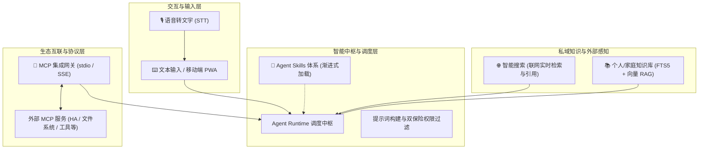

# 核心能力扩充执行计划（Capabilities Expansion）

> **状态**：🚧 Phase E 设计进行中  
> **关联**：`AI-PRD.md §8.12–§8.16`、`docs/specs/`  
> **核心目标**：将「智能搜索」、「语音转文字输入」、「个人与家庭知识库」、「Agent Skills 扩展体系」、「MCP 集成体系」五大能力，按“契约先行、确定性边界包络、渐进式深化”的原则落地至 HomeAgent 系统。

---

## 1. 能力全景与工程定位



---

## 2. 五大功能特性矩阵

| 能力模块 | 业务价值 | 核心组件 | 确定性代码边界 | 关键不变量与安全防线 |
|---|---|---|---|---|
| **M8 语音转文字 (Voice STT)** | 释放双手，支持厨房/家务/开车场景下一键语音录入 | Web Audio 录音器 + 后端 Whisper 适配器 | 音频格式校验、最大时长截断(60s)、速率限制 | 不保留常开麦克风；仅作文本录入辅助，不作为提权认证凭证 |
| **M7 智能搜索 (Smart Search)** | 获取实时政策、天气、维修常识，消除模型事实幻觉 | `web_search` 工具 + Tavily/Brave 适配器 + 引用卡片 | 域名黑白名单、超时熔断、外网防注入清洗 | 搜索结果进上下文前强制标注“不可信外部内容”，抹除伪造指令 |
| **M9 家庭知识库 (Family KB)** | 沉淀家庭说明书、保单、体检单、私房备忘，精准问答 | 文档切片器 + SQLite FTS5 + 向量检索 (RAG) | 权限双保险（公开 vs 个人私密）、Token 预算截断 | 敏感保单与体检数据按 member_id 严格隔离；禁止未经授权全家庭灌入 |
| **M10 Agent Skills (技能包)** | 模块化解耦专业场景，避免系统提示词超长与注意力分散 | 声明式 Skill YAML + 技能索引路由 + 按需注入 | 依赖工具权限校验、系统 Prompt 长度限额 | 意图未命中时不占用 LLM 上下文；技能写操作必须实现 Undo |
| **M11 MCP 集成体系 (MCP Gateway)** | 连接广阔开源生态，动态接入设备控制、文件与外部服务 | MCP Client (stdio/SSE) + 动态工具映射器 | 动态工具参数校验、子进程生命周期守护、超时熔断 | 外部 MCP 写操作必须接入 ADR-004 可撤销或降级为 A3 人工确认强卡点 |

---

## 3. 依赖关系与深化设计推进路线

按**“输入先行 → 外部增强 → 私域深化 → 插件抽象 → 协议生态”**的稳健工程次序逐步深化：

```
第 1 步：语音转文字 (STT)      --> 极佳的用户体验立竿见影，解耦性最高
第 2 步：智能搜索 (Search)     --> 工具注册表标准化扩展，增强 Agent 解决事实问题的能力
第 3 步：个人知识库 (KB/RAG)    --> 引入轻量级混合检索（SQLite FTS5 + Embeddings），打通家庭私域记忆
第 4 步：Agent Skills 体系    --> 梳理领域提示词与工具集，建立规范的声明式扩展标准
第 5 步：MCP 集成体系         --> 抽象通用协议网关，打通外部进程与生态联动
```

---

## 4. 任务清单（Task Checklist）

### 阶段一：功能清单固化与总体架构规格（当前）
- [x] 更新 `AI-PRD.md` §8 迭代边界（新增 8.12~8.16）。
- [x] 更新 `AGENTS.md` 与 `docs/exec-plans/README.md` 索引。
- [x] 编制五大功能独立深化设计规格文档（`docs/specs/`）：
  - [x] `docs/specs/01-voice-stt-design.md`（语音转文字深化设计）
  - [x] `docs/specs/02-smart-search-design.md`（智能搜索深化设计）
  - [x] `docs/specs/03-knowledge-base-design.md`（个人知识库深化设计）
  - [x] `docs/specs/04-agent-skills-design.md`（Skills 扩展体系深化设计）
  - [x] `docs/specs/05-mcp-integration-design.md`（MCP 集成体系深化设计）

### 阶段二：OpenAPI 契约先行与模型生成（待开始）
- [ ] 扩展 `api/openapi.yaml`：
  - [ ] 语音转文字接口：`POST /api/v1/voice/transcribe`
  - [ ] 知识库管理接口：`GET/POST /api/v1/knowledge/documents`，`POST /api/v1/knowledge/query`
  - [ ] Skills 管理接口：`GET /api/v1/skills`，`POST /api/v1/skills/{id}/toggle`
  - [ ] MCP 服务配置接口：`GET/POST /api/v1/admin/mcp/servers`，`POST /api/v1/admin/mcp/servers/{id}/test`
- [ ] 执行 `make generate`（生成 Go 接口与前端 TS 类型）。

### 阶段三：逐个功能实施与自测联调（待开始）
- [ ] **M8 语音输入**：前端录音组件 + 后端 Whisper 适配层落地。
- [ ] **M7 智能搜索**：`web_search` 工具 + Tavily/Brave 客户端 + 引用卡片渲染。
- [ ] **M9 知识库**：SQLite FTS5 + 向量嵌入 + 权限隔离检索 + 上下文注入。
- [ ] **M10 Skills 体系**：技能目录定义 + 渐进式发现器 + Admin 技能卡片。
- [ ] **M11 MCP 网关**：stdio 进程客户端 + 工具动态注册 + 双保险权限与人工确认拦截。

---

## 5. 决策日志（Decision Log）

### 决策 1：知识库选型采用 SQLite FTS5 + 外部嵌入，而非引入重量级向量数据库 (Milvus/Chroma)
- **理由**：HomeAgent 定位为个人与家庭自用系统，运行于单 VPS 或轻量家庭服务器。引入独立的 Python 依赖或重型 Java/C++ 向量服务会极度增加部署与维护成本。
- **方案**：采用纯 Go 友好的 SQLite 全文检索（FTS5）保障极速中文关键字匹配，搭配可选的轻量嵌入向量（存储在 SQLite 中计算余弦相似度），实现极简轻量化的“混合检索（Hybrid RAG）”。

### 决策 2：MCP 集成必须经由 HomeAgent 确定性安全执行器与 ADR-004 包装
- **理由**：外部 MCP 协议允许 Server 任意暴露工具，若直接透传给 LLM 且无状态拦截，可能导致未授权文件修改或不可逆外部命令。
- **方案**：所有 MCP 发现的外部工具，必须在运行时自动注册为经过 `PermissionLookup` 过滤的 ToolSpec；若工具产生写操作且未声明补偿撤销逻辑，运行时强制将其危险等级提升至 A3，必须经过用户确认弹窗方可执行。
