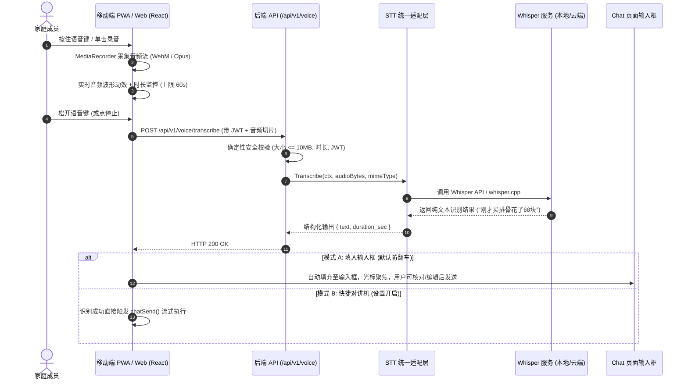

# 语音输入与转文字深化设计（Voice STT Design）

> **模块编号**：M8（Voice & Speech-to-Text）  
> **文档定位**：技术规格与架构设计说明书（Phase E 第一顺位）  
> **对齐标准**：AI-STD-003（架构标准）、AI-STD-004（上下文与隐私）、ADR-005（权限与安全）

---

## 1. 业务场景与解决的痛点

在真实的家庭生活场景中，**双手被占用是常态，打字录入是高频摩擦源**：
1. **厨房烹饪**：手上有水、有油或正在翻炒，需要快速询问“这道菜老抽放多少”、“焯水要冷水还是沸水”，打字极易弄脏手机。
2. **买菜与购物**：手里拎着袋子，在超市门口需要快速记账“刚才买排骨 68 块钱，买了 3 斤苹果 18 块钱”。
3. **日常家务与驾车**：拖地/开车过程中，需要记录“车子刚加了 320 块钱油”或“提醒我明早倒垃圾”。

通过轻量化语音转文字（STT），让家庭成员用“对讲机”般的自然体验与 Agent 交互。

---

## 2. 系统架构与数据流图



---

## 3. 后端架构设计与接口契约

### 3.1 统一适配器接口设计（Go）

```go
package voice

import (
	"context"
	"io"
)

// TranscribeOptions 转写参数
type TranscribeOptions struct {
	Language       string   // 默认 "zh"
	Prompt         string   // 引导热词（如家庭成员名、特定菜名）
	Temperature    float32  // 默认 0.0
}

// TranscribeResult 转写返回结果
type TranscribeResult struct {
	Text        string  `json:"text"`
	DurationSec float64 `json:"duration_sec"`
	Language    string  `json:"language"`
}

// Provider STT 统一抽象，屏蔽底层是云端 OpenAI 还是本地 whisper.cpp
type Provider interface {
	Name() string
	Transcribe(ctx context.Context, audioReader io.Reader, filename string, opts TranscribeOptions) (*TranscribeResult, error)
}
```

### 3.2 支持的后端引擎（可配置切换）

1. **OpenAI Whisper 适配器**：
   - 调用 `v1/audio/transcriptions` 接口（`model: whisper-1`）。
   - 兼容 One-API / 硅基流动 / 深度求索兼容中转等第三方平台。
2. **本地 Whisper 适配器（推荐极客家庭）**：
   - 接入内网局域网运行的 `whisper.cpp`（HTTP server 模式）或 `faster-whisper-server`。
   - 数据完全不出家庭局域网，响应速度更快，零 Token 成本。
3. **降级策略**：
   - 若未配置 STT API Key，前端可降级使用浏览器原生的 `webkitSpeechRecognition`（Chrome/Edge/Android WebKit 支持）。

### 3.3 OpenAPI 接口契约草案

```yaml
/voice/transcribe:
  post:
    tags: [voice]
    summary: 语音转文字接口
    description: 接收音频文件切片，转写为高精度文本返回
    security:
      - BearerAuth: []
    requestBody:
      required: true
      content:
        multipart/form-data:
          schema:
            type: object
            required: [file]
            properties:
              file:
                type: string
                format: binary
                description: 音频文件（支持 webm, wav, m4a, mp3, ogg）
              language:
                type: string
                default: "zh"
                description: 音频主语言
              hotwords:
                type: string
                description: 辅助热词（提示词），如家人昵称或菜名
    responses:
      '200':
        description: 转写成功
        content:
          application/json:
            schema:
              type: object
              required: [text]
              properties:
                text:
                  type: string
                  example: "今天去超市买排骨花了68元"
                duration_sec:
                  type: number
                  example: 3.2
      '400':
        $ref: '#/components/responses/BadRequest'
      '413':
        description: 音频文件过大（超过 10MB）
      '502':
        description: STT 引擎调用失败
```

---

## 4. 前端交互与组件设计（移动端友好）

### 4.1 核心组件划分
- `web/src/components/VoiceRecorder/`：
  - `VoiceButton.tsx`：麦克风入口按钮，支持单击启动/停止，或移动端长按手势。
  - `VoiceWaveModal.tsx`：录音过程中的声波脉冲反馈卡片（利用 Web Audio `AnalyserNode` 实时绘制声波动效）。
  - `useVoiceRecorder.ts`：封装 `navigator.mediaDevices.getUserMedia`、`MediaRecorder` 状态机与分片组装。

### 4.2 交互状态机（FSM）
```
[IDLE 闲置] 
  │ 用户按下 / 单击
  ▼
[REQUESTING 请求权限] ──(拒绝)──> [ERROR 提示授权麦克风]
  │ 授权成功
  ▼
[RECORDING 录音中] ──(上滑取消)──> [CANCELLED 丢弃音频]
  │ 达到 60s 限制 或 用户松手
  ▼
[TRANSCRIBING 转写中] (显示加载呼吸灯)
  │ 后端返回文本
  ▼
[SUCCESS 填入输入框] ──(自动聚焦)──> [IDLE 闲置]
```

---

## 5. 确定性边界与安全不变量

1. **绝对不持久化音频文件（隐私第一不变量）**：
   - 音频数据在后端内存中作为 stream 转发给 STT 引擎后即销毁；
   - 本地磁盘禁止落盘保存用户的语音原声切片，防范家庭隐私泄露。
2. **严防常驻偷听**：
   - Web 客户端仅在用户显式按下触发录音时才向浏览器请求并激活麦克风流，录音结束立即调用 `track.stop()` 关闭硬件指示灯。
3. **速率与体积限制**：
   - 单次上传音频限制最大 10MB，最长 60 秒；
   - 单成员 1 分钟内最多调用 10 次，防止误触或异常循环刷爆 Token。
4. **不作身份鉴权凭证**：
   - 语音转写仅作为“键盘打字的平替输入通道”，执行写操作时依然严格根据 HTTP Header 中的 JWT 判定角色权限。
