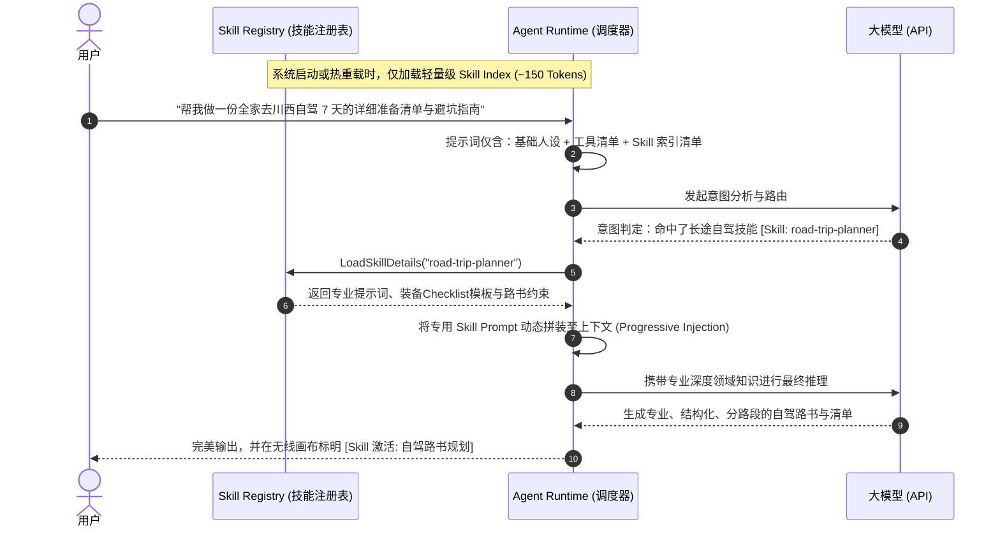

# Agent Skills 扩展体系深化设计（Agent Skills Architecture）

> **模块编号**：M10（Agent Skills · 声明式技能与渐进式加载体系）  
> **文档定位**：技术规格与架构设计说明书（Phase E 第四顺位）  
> **对齐标准**：AI-STD-003（架构标准）、AI-STD-004（最小上下文策略）、ADR-005（权限双保险）

---

## 1. 业务场景与解决的痛点

随着 HomeAgent 支持的家庭场景越来越多（深度财务分析、家庭私房名菜精调、长途自驾路书、阳台绿植养护、养宠打卡、个税专项附加扣除），传统架构面临致命瓶颈：
1. **全局 System Prompt 上下文爆炸**：若将所有场景的专业引导词、输出格式要求和 Few-shot 样例全部塞入系统提示词，单次对话基础开销将超 10,000 Token，成本高昂且首包延迟严重恶化。
2. **大模型注意力稀释（Attention Dilution）**：提示词堆砌过多规则，LLM 极易遗忘约束，导致指令遵循度显著下降。
3. **领域模块耦合严重**：每增加一个家庭细分场景就要重构全局提示词，缺乏独立封装与插件化扩展机制。

通过引入**声明式、自包含、渐进式加载（Progressive Discovery）的 Agent Skills 体系**，实现“轻量常驻索引 + 意图命中动态注入”。

---

## 2. 渐进式技能加载架构（Progressive Discovery）



---

## 3. 标准技能包规范（Skill Manifest Specification）

每个技能为独立文件夹，存放于项目 `skills/` 或运行时数据目录下：

```
skills/
└── road-trip-planner/
    ├── SKILL.md            # 核心技能清单与提示词规范
    └── templates/          # 可选模版（如装备清单 JSON）
```

### `SKILL.md` 规范模版样例

```markdown
---
name: "road-trip-planner"
title: "家庭长途自驾与出游规划助手"
version: "1.0.0"
description: "当用户计划进行跨城长途自驾、露营野餐或亲子自驾游，需要路线规划、爱车整备、行李防漏清单与高原/山路驾驶安全指南时激活。"
category: "travel"
required_tools:
  - "list_my_tasks"
  - "assign_task"
  - "record_expense"
  - "web_search"
required_role: "parent"
---

# 家庭长途自驾规划指南

你现在是家庭自驾出行专家。当本技能激活时，你需要遵循以下准则：

## 1. 结构化输出规范
- **第一部分：路线与关键补给节点**（高速路段、预计油耗/电耗、必停服务区）；
- **第二部分：爱车出游前安全自检**（胎压检查、刹车油、应急工具箱）；
- **第三部分：分工清单**（自动调用 `assign_task` 为家庭成员拆解任务：如爸爸检查车况、妈妈准备医药包）；
- **第四部分：防漏装备 Checklist**（结合是否有儿童/老人调整）。

## 2. 安全与避坑原则
- 连续驾驶不超过 4 小时，强制提示换人或进服务区休息；
- 若目的地包含高海拔或山区，主动提示高原反应药物与防滑链。
```

---

## 4. 后端核心机制实现（Go）

### 4.1 核心数据结构

```go
package skill

type SkillManifest struct {
	Name         string   `yaml:"name"`
	Title        string   `yaml:"title"`
	Version      string   `yaml:"version"`
	Description  string   `yaml:"description"`
	Category     string   `yaml:"category"`
	RequiredTools []string `yaml:"required_tools"`
	RequiredRole string   `yaml:"required_role"`
	PromptBody   string   // Markdown 正文内容
	Enabled      bool     // 是否启用
}

type Registry interface {
	LoadAll(dir string) error
	GetIndexPrompt(memberRole string) string // 生成轻量级技能索引摘要
	FindSkill(name string) (*SkillManifest, bool)
	ToggleSkill(name string, enabled bool) error
}
```

### 4.2 提示词注入阶段控制（Prompt Phase Injection）
- **常驻层（Skill Index）**：在系统提示词末尾仅追加极简表格：
  ```markdown
  ## 可选专业技能索引 (按需匹配):
  - [road-trip-planner]: 家庭长途自驾规划与车况整备
  - [deep-finance-audit]: 家庭月度财务深度收支审计与超支诊断
  - [culinary-mastery]: 私房大菜制作与火候步骤深度辅导
  ```
- **激活层（Activated Body）**：当模型决定激活某个技能或通过意图分类器命中时，将该技能的 `PromptBody` 注入到当前轮次消息流上方，确保当轮具备最高专家级表现。

---

## 5. 确定性边界与安全不变量

1. **依赖工具权限双重收敛（ADR-005）**：
   - Skill 在 Frontmatter 中声明的 `required_tools`，不能突破当前登录成员的身份权限矩阵；
   - 若孩子角色触发了需要调用 `set_budget` 的技能，该工具依然在执行器层被**强行拦截**并报错，Skill 绝不能成为提权后门。
2. **拒绝任意不可信二进制执行**：
   - 技能包仅包含规范的 Markdown 指令与模板配置；
   - 严禁 Skill 直接在宿主机执行未经安全审计的 shell 脚本或动态代码，所有物理副作用必须经由 HomeAgent 的标准 Go 工具层。
3. **Admin 动态管控**：
   - 管理后台支持可视化查看所有已加载 Skills，支持一键热启停，修改后无需重启 Go 后端进程。
